# base-rpc 架构图

源码均在 `src/common/{net,serde}`,命名空间 `hf3fs::net` / `hf3fs::serde`。

## 1. 分层总览

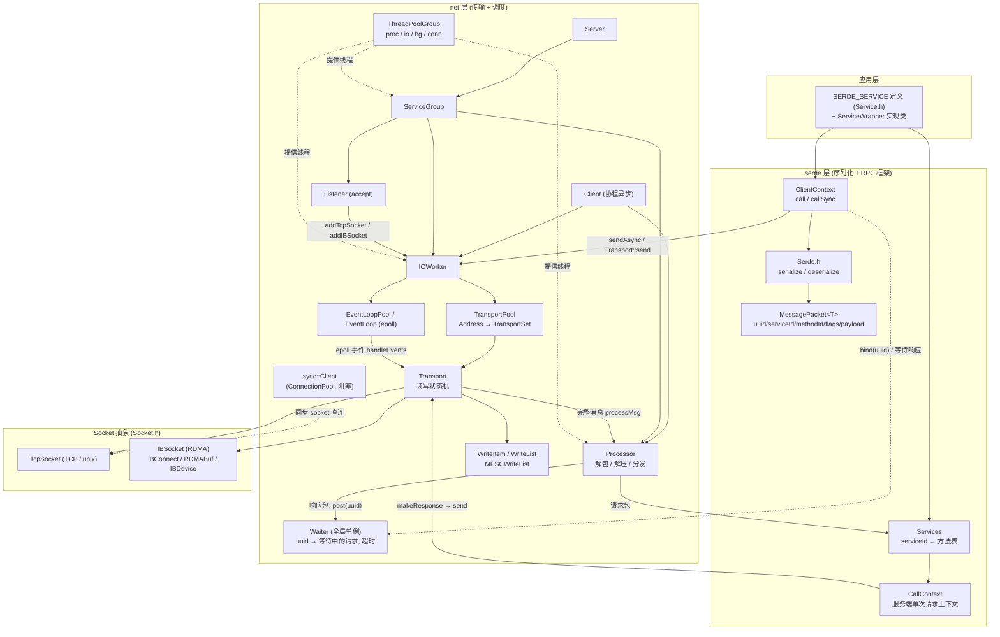

## 2. 类归属 / 持有关系

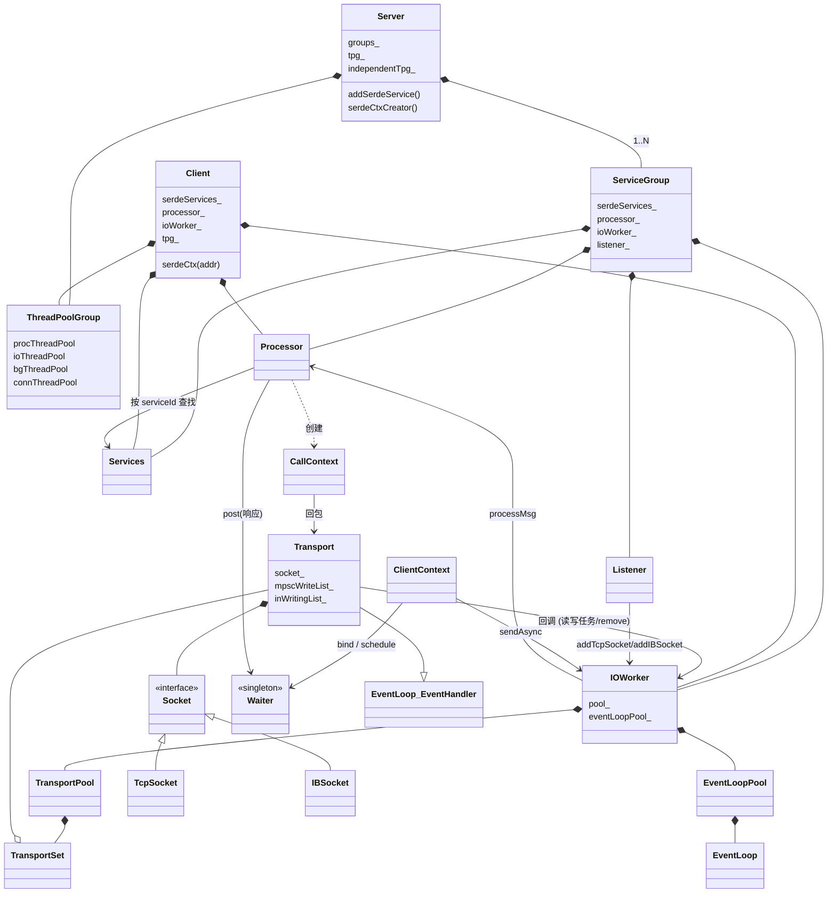

要点:
- **Server 与 Client 结构对称**:都是 `Services + Processor + IOWorker`,区别是 Server 多了 `Listener`、多组 `ServiceGroup`(每组可选 TCP/RDMA);Client 仅注册 `RDMAControlImpl` 服务。
- **Processor 同时处理请求和响应**:请求 → `Services` → `CallContext`;响应 → `Waiter::post(uuid)` 唤醒调用方。
- **Transport 既是连接也是 epoll handler**:`EventLoop` 触发 `handleEvents` → `IOWorker::startReadTask/startWriteTask` 在 io 线程池上收发。

## 3. 一次 RPC 调用的详细时序

> 以下以 TCP + 协程异步调用 (`ClientContext::call`,持有 `IOWorker*`) 为主线,RDMA / 同步客户端的差异在各节末尾单独标注。
> 整个调用拆成 6 个阶段:**① 客户端构包发送 → ② 连接获取/建立 → ③ Transport 写出 → ④ 服务端读取与分发 → ⑤ 业务执行与回包 → ⑥ 客户端收响应**,另有 **⑦ 超时/失败路径**。

### 3.0 全景(精简版)

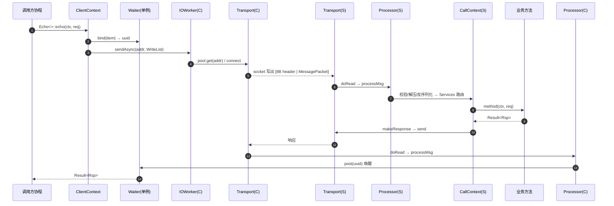

**文字说明**(按图中顺序)

1. 调用方协程执行 `Echo<>::echo(ctx, req)`,`ClientContext` 先在 `Waiter` 里登记一个 uuid,作为这次请求的"取件号"。
2. 请求被序列化成 `[8B header | MessagePacket]`,交给 `IOWorker::sendAsync`,由它从连接池取一条到目标地址的连接(没有就新建),把消息放进该连接的发送队列。
3. 客户端 `Transport` 把数据写进 socket,服务端 `Transport` 读到后交给 `Processor`:校验、解压、反序列化,再按 `serviceId` 在 `Services` 里找到服务。
4. `CallContext` 按 `methodId` 调到业务方法,业务返回 `Result<Rsp>`,`makeResponse` 把它打包后原路写回。
5. 客户端的 `Processor` 收到响应帧,按 uuid 调 `Waiter::post`,唤醒挂起的调用协程,调用方拿到 `Result<Rsp>`。

整个过程中调用方协程只在 `co_await baton` 处挂起一次,不占用线程。

### 3.1 阶段①:客户端构包与发送(`ClientContext::call`)

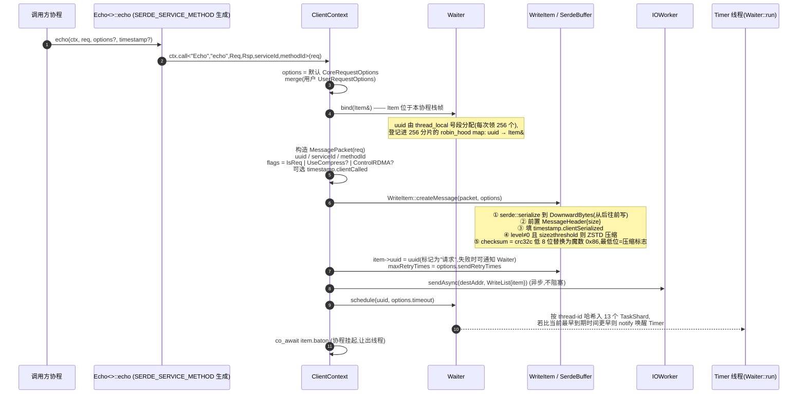

**文字说明**

1. 调用方走到 `SERDE_SERVICE_METHOD` 生成的静态方法,它把服务名、方法名、`serviceId`、`methodId` 作为模板参数转给 `ClientContext::call`。
2. `call` 取默认 `CoreRequestOptions`(超时、重试次数、压缩、是否 RDMA 控制),再合并调用方传入的 `UserRequestOptions`。
3. `Waiter::bind(item)` 登记等待项并返回 uuid。uuid 从线程本地号段里取,不同线程互不竞争。`item` 存放在本协程的栈帧里,`Waiter` 只保存引用。
4. 构造 `MessagePacket`:填 uuid、serviceId、methodId、flags(`IsReq`,按配置加 `UseCompress`、`ControlRDMA`),需要时记下 `clientCalled` 时间戳。
5. `WriteItem::createMessage` 把包序列化到一块缓冲区(从后往前写),在前面补 8 字节 header。启用压缩且长度达到阈值时做 ZSTD 压缩,最后计算 crc32c 写入 header。
6. 把 uuid 写进 `WriteItem`,让它被识别为"请求";这样发送失败时能通过 `Waiter::sendFail` 通知到调用方。
7. `IOWorker::sendAsync` 只负责入队,不会阻塞。随后 `Waiter::schedule(uuid, timeout)` 把超时任务交给 Timer 线程,最后 `co_await item.baton` 挂起。

要点:
- **uuid 是请求/响应匹配的唯一键**。`Waiter::Item` 直接放在调用协程的栈帧里,`Waiter` 只存引用,所以协程恢复前该 Item 必须一直有效。
- **先 `sendAsync` 再 `schedule`**:超时计时从发送之后算起;`sendAsync` 本身不会阻塞,即使连接还没建好也只是把消息入队。
- **`WriteItem::isReq()` 用 `uuid != SIZE_MAX` 判断**:响应包的 `WriteItem` uuid 保持默认值,这样发送失败时只会对"请求"通知 `Waiter::sendFail`。
- 线上格式见 §3.8。

### 3.2 阶段②:获取 / 建立连接(`IOWorker::sendAsync` → `TransportPool` → `connect`)

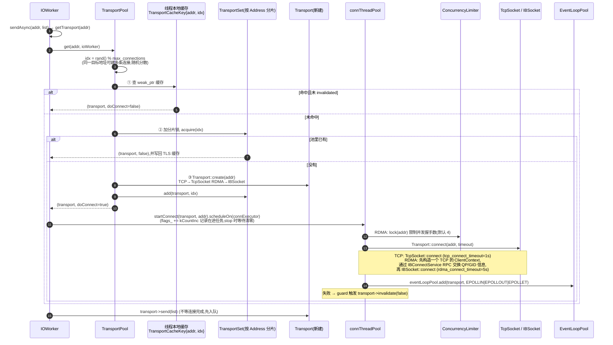

**文字说明**

1. `sendAsync` 先调用 `getTransport(addr)`,进入 `TransportPool::get`。
2. 池子先随机生成 `idx`(范围是 `max_connections`),让同一目标地址最多有多条并行连接。
3. 第一级:查线程本地缓存。命中且连接未失效就直接返回,全程无锁。
4. 第二级:未命中则加分片锁,在该地址的 `TransportSet` 里找 `idx` 槽位,找到就返回并回填线程缓存。
5. 第三级:都没有就按地址类型创建 Transport(TCP 对应 `TcpSocket`,RDMA 对应 `IBSocket`),登记到池里,并返回 `doConnect=true`。
6. `doConnect=true` 时,`IOWorker` 把 `startConnect` 投递到 `connThreadPool` 异步执行,并给在途任务计数加一,停止时会等它归零。
7. 连接协程:RDMA 先过并发限制器;然后 `Transport::connect`。TCP 直接 `connect`;RDMA 先走一次 TCP RPC 交换 QP/GID,再建立 IB 连接。
8. 连上后把 Transport 以 `EPOLLIN|EPOLLOUT|EPOLLET` 加入 `EventLoopPool`;失败则执行 `invalidate(false)`。
9. 无论连没连上,`sendAsync` 随后都会立即 `transport->send(list)`,把消息放进队列,等连接就绪后再真正写出。

要点:
- **连接是懒建立、异步完成的**:`get` 创建并登记 Transport 后立即返回,真正的 `connect` 在 `connThreadPool` 协程里跑,调用方协程不被阻塞,它已经 `co_await baton` 了。消息先留在 `MPSCWriteList`,连上后第一次 EPOLLOUT 事件到来时才被写出(见 §3.3)。
- **TLS 缓存 + 分片锁**:热路径零锁(命中 TLS);未命中才走分片锁。
- **同一 Address 下的 `TransportSet`** 用 `idx` 做槽位,`max_connections` 控制多连接并发度。
- **RDMA 的连接握手本身就是一次 TCP RPC**,所以 RDMA 的 ServiceGroup 会额外把 `IBConnectService` 注册在 TCP 表里(`Listener::start`)。
- 服务端对端的接入路径:`Listener::listen` 循环 `accept` → `acceptTCP` → `IOWorker::addTcpSocket`(创建 Transport、`pool_.add`、加入 epoll);RDMA 则是 `IBConnectService` 回调 → `acceptRDMA` → `addIBSocket`。

### 3.3 阶段③:Transport 写出路径(`send` → `doWrite`)

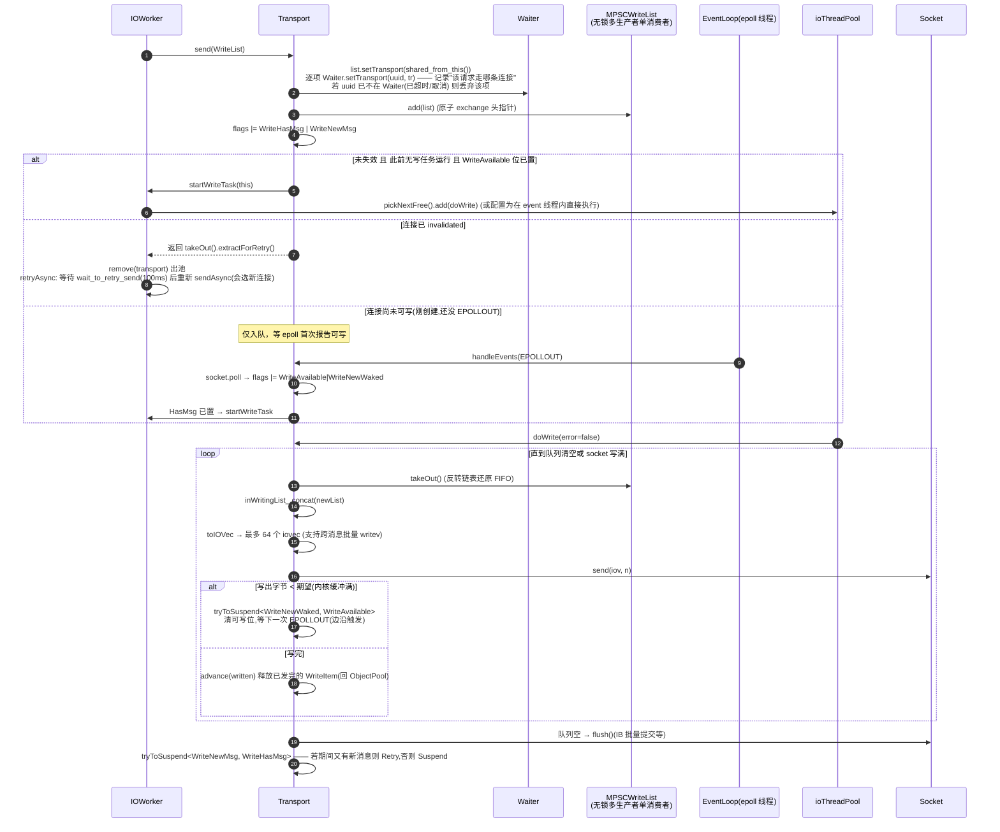

**文字说明**

1. `Transport::send` 先把每个请求项绑定到当前 Transport(`Waiter::setTransport`),以后这条连接出错时能找到受影响的请求;uuid 已不在 `Waiter` 里(已超时)的项直接丢弃。
2. 消息被无锁地追加到 `MPSCWriteList`,同时设置 `WriteHasMsg|WriteNewMsg` 标志。
3. 判断是否需要拉起写任务:未失效、此前没有写任务在跑、且 socket 当前可写,就 `startWriteTask`,由 io 线程执行 `doWrite`。
4. 如果连接已失效,把队列里的消息取出做"重试提取",交给 `IOWorker`:先把这条 Transport 从池里移除,100ms 后用新连接重发。
5. 如果连接刚建好、还没收到过 EPOLLOUT,消息只是留在队列里。等 epoll 首次报告可写,`handleEvents` 置位 `WriteAvailable`,因为 `WriteHasMsg` 已经置位,于是拉起写任务。
6. `doWrite` 循环:取出队列、拼到 `inWritingList_`、转成最多 64 个 iovec,一次 `send` 批量写出;每次写完按已写字节数推进并释放写完的 `WriteItem`。
7. 内核发送缓冲满(写出字节小于预期)时,清除 `WriteAvailable` 并挂起,等下一次 EPOLLOUT 再继续。
8. 队列为空时先 `flush`,再用 `tryToSuspend` 做最后检查:期间若又有新消息入队就重试,否则挂起并清 `WriteHasMsg`。

要点:
- **读/写任务靠一组原子 flag 做"无锁状态机"** (见 §5),保证同一时刻最多一个读任务、一个写任务在跑,同时避免丢失唤醒。
- **EPOLLET(边沿触发)**:必须读/写到 EAGAIN 才挂起,所以 `doRead/doWrite` 都是 while 循环。
- **批量写**:多个调用并发 `send` 的消息被合并进同一个 `inWritingList_`,一次 `writev` 发出,摊薄系统调用。
- **失败重试**:`extractForRetry` 对每个请求 `retryTimes++ < maxRetryTimes`(默认 1 次)才保留并重投,否则 `Waiter::sendFail(uuid)` → 调用方得到 `kSendFailed`。

### 3.4 阶段④:服务端读取、解包与分发

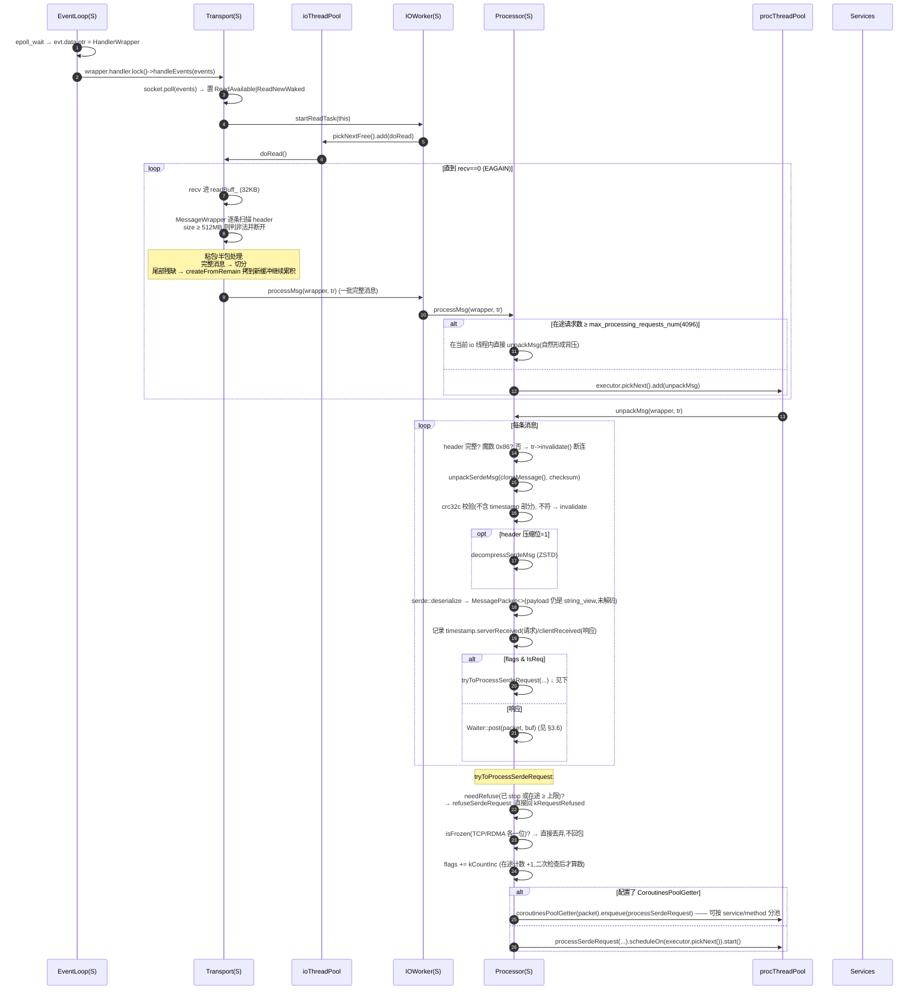

**文字说明**

1. `EventLoop` 线程在 `epoll_wait` 返回后,通过 `HandlerWrapper` 找到对应的 Transport,调用它的 `handleEvents`。
2. `handleEvents` 先 `socket.poll` 得到可读/可写,置位相应 flag,然后投递读任务到 io 线程池(或按配置直接在当前线程执行)。
3. `doRead` 循环 `recv` 到 32KB 的 `readBuff_`,直到读到 0 字节(EAGAIN)。
4. 每次读完用 `MessageWrapper` 扫描:`size` 超过 512MB 视为非法;完整的消息一起切分,尾部残缺的部分拷到新缓冲继续累积(解决粘包/半包)。
5. 一批完整消息交给 `Processor::processMsg`。在途请求数达到上限时直接在当前线程处理(形成背压),否则投到 proc 线程池。
6. `unpackMsg` 逐条处理:检查 header 完整性和魔数,校验 crc32c,必要时 ZSTD 解压,再反序列化出 `MessagePacket`(payload 仍保持原始字节视图)。任一步失败都 `invalidate` 断开连接。
7. 记录时间戳:请求记 `serverReceived`,响应记 `clientReceived`。然后按 `IsReq` 分流:请求进 `tryToProcessSerdeRequest`,响应走 `Waiter::post`。
8. `tryToProcessSerdeRequest` 依次判断:已停止或在途数超限则立即回 `kRequestRefused`;被冻结则静默丢弃;否则在途计数加一,并把 `processSerdeRequest` 协程交给 proc 线程池(或自定义的 `DynamicCoroutinesPool`)执行。

要点:
- **三层线程接力**:epoll 线程(只分发事件)→ io 线程(收发字节、拆包)→ proc 线程(校验、解压、反序列化、跑业务)。可通过 `read_write_*_in_event_thread` 把 io 层并入 epoll 线程以减少切换。
- **Processor 同时是请求和响应的入口**:靠 `IsReq` 标志区分,所以 Client 和 Server 用同一个类。
- **优雅关停 / 过载保护**都在 `Processor::flags_` 里:最低位 stop、两位 frozen(TCP/RDMA)、其余位是在途计数。`stopAndJoin` 置 stop 位后轮询等计数清零。
- 任何协议错误(魔数、校验和、消息过大、反序列化失败)的处理都是 **`tr->invalidate()` 断开连接**,而不是回错误包。

### 3.5 阶段⑤:服务路由、业务执行与回包

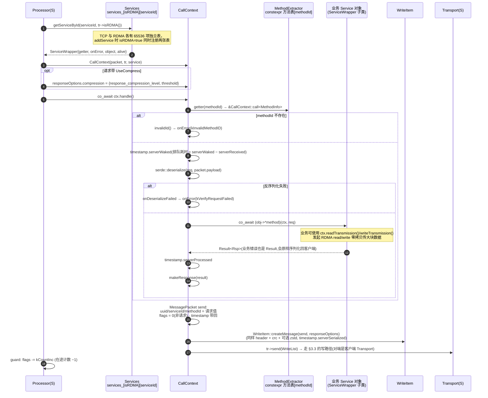

**文字说明**

1. `processSerdeRequest` 用 `serviceId` 和连接类型(TCP/RDMA)在 `Services` 里取出 `ServiceWrapper`,里面有方法表入口、错误处理函数、服务对象指针和存活引用。
2. 创建 `CallContext`。如果请求带 `UseCompress`,就为响应设置压缩参数。
3. `ctx.handle()` 通过 `getter(methodId)` 取得 `&CallContext::call<F>`。`methodId` 不存在则走 `invalidId`,回 `kInvalidMethodID`。
4. `call<F>` 记录 `serverWaked`(排队耗时就是它和 `serverReceived` 的差),把 payload 反序列化成请求对象;失败回 `kVerifyRequestFailed`。
5. 调用业务方法 `(obj->*method)(ctx, req)`。业务可以用 `ctx` 发起 RDMA read/write 传输大块数据。业务错误也包在 `Result` 里,会原样返回给客户端。
6. 记录 `serverProcessed`,调用 `makeResponse`:沿用请求的 uuid、serviceId、methodId,`flags=0`,带回 timestamp,序列化成 `WriteItem`。
7. 通过 `tr->send` 写回,走和 3.3 相同的写路径。最后 guard 把在途计数减一。

要点:
- **路由是编译期构建的**:`SERDE_SERVICE_METHOD` 通过反射宏收集方法表,`MethodExtractor` 在 `consteval` 里生成 `methodId → &CallContext::call<F>` 的函数指针数组;运行时只是数组下标查找,无哈希、无虚函数。
- **`Services` 持有 `shared_ptr` 的别名(`alive`)** 保证服务对象在请求处理期间不被销毁。
- **回包复用 Transport::send**,响应帧结构与请求完全相同,只是 `flags` 的 `IsReq` 位为 0,`WriteItem.uuid` 不设(不是 "请求")。
- 可以自定义 `Service::onError(Status)` 改写错误码(`customOnError`)。
- 业务抛异常会 `XLOGF(FATAL)`:约定业务方法必须通过 `Result` 返回错误。

### 3.6 阶段⑥:客户端接收响应并唤醒调用方

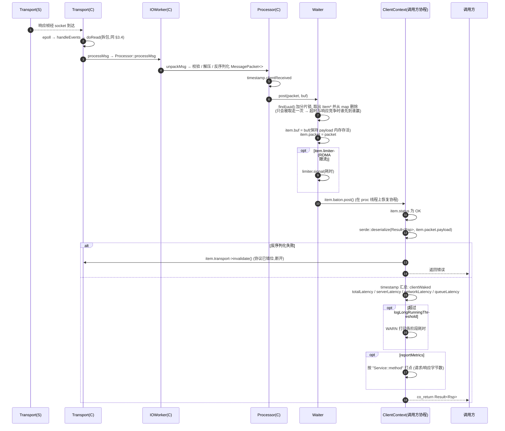

**文字说明**

1. 响应帧到达客户端 Transport,经过和 3.4 相同的读取、拆包、校验、解压、反序列化,得到 `MessagePacket`。
2. `Processor` 记 `clientReceived`,调用 `Waiter::post(packet, buf)`。
3. `post` 内部的 `find(uuid)` 会把 Item 从 map 里取出并删除,所以每个请求只会被"取走"一次。超时和响应同时到达时,先取到的一方生效,另一方什么也不做。
4. `post` 把响应缓冲和 packet 存进 Item(缓冲要保活,payload 才有效);有 RDMA 限流器则通知它;然后 `baton.post()` 在 proc 线程上恢复调用协程。
5. 调用协程把 payload 反序列化成 `Result<Rsp>`。失败说明协议已错位,会 `invalidate` 这条连接并返回错误。
6. 成功则汇总 timestamp(总耗时、服务端耗时、网络耗时、排队耗时);超过 `logLongRunningThreshold` 时打 WARN;开启 `reportMetrics` 则按 `Service::method` 打点,最后返回结果。

### 3.7 阶段⑦:超时 / 失败 / 重试路径

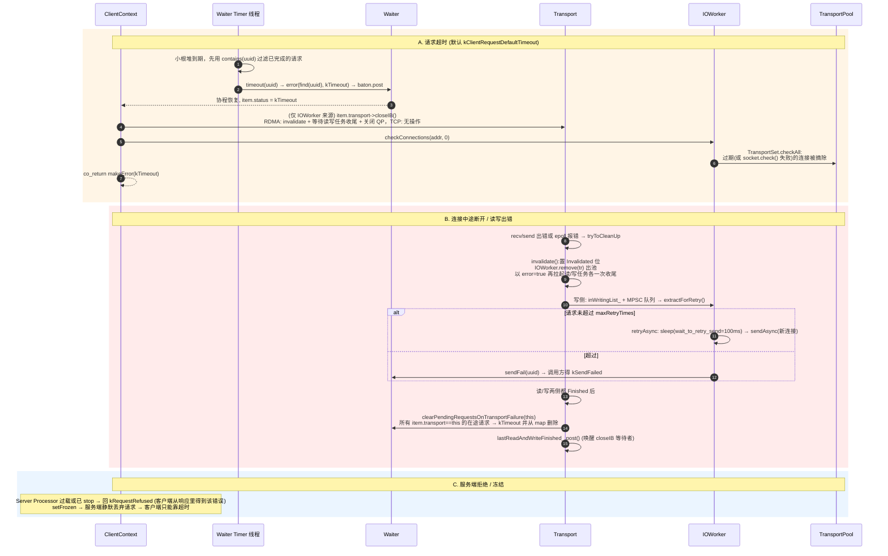

**文字说明**

**A. 请求超时**:Timer 线程的小根堆到期,先用 `contains(uuid)` 过滤已完成的请求,再 `Waiter::timeout`,调用协程以 `kTimeout` 恢复。若是 `IOWorker` 来源的调用,还会 `closeIB`(只对 RDMA 有实际动作)并 `checkConnections(addr, 0)`,摘掉过期或健康检查失败的连接。

**B. 连接出错**:读写出错或 epoll 报错时进入 `tryToCleanUp` → `invalidate`:置失效位,把 Transport 移出池,再各拉起一次读/写任务做收尾。写侧把未发完和队列中的请求提取出来:没超过 `maxRetryTimes` 的 100ms 后换新连接重发,超过的直接 `sendFail`(调用方得到 `kSendFailed`)。读写两侧都收尾后,`clearPendingRequestsOnTransportFailure` 把所有绑定在这条连接上的在途请求以 `kTimeout` 结束。

**C. 服务端拒绝/冻结**:服务端过载或已停止时回 `kRequestRefused`,客户端从响应里得到这个错误;被冻结时服务端静默丢弃,客户端只能等超时。

### 3.8 线上帧格式

源码:`common/net/MessageHeader.h`、`common/net/WriteItem.h`(`SerdeBuffer`)、`common/serde/MessagePacket.h`、`common/serde/Serde.h`。

#### 3.8.1 帧结构

每条消息 = 8 字节定长头 + 变长 body。请求与响应共用同一种帧。

```
 0                4                8
 ┌────────────────┬────────────────┬──────────────────────────────────┐
 │ checksum: u32  │ size: u32      │ body (size 字节)                  │
 │                │                │ serde(MessagePacket<T>)           │
 │                │                │ [可选 ZSTD 压缩]                   │
 └────────────────┴────────────────┴──────────────────────────────────┘
        MessageHeader (8B)
```

| 字段 | 含义 |
|---|---|
| `checksum` | `crc32c(body)`,低 8 位被替换为魔数 `0x86`;bit0 兼作压缩标志(1 = body 已压缩) |
| `size` | body 长度,上限 `kMessageMaxSize` = 512MB |

- 头部直接 `reinterpret_cast` 读写,不做字节序转换(主机字节序,x86 为小端)。
- 魔数判断:`(checksum & 0xfe) == 0x86`;不满足则 `Processor` 将连接 `invalidate()`。
- CRC 实际只有高 24 位有效(低 8 位给了魔数和压缩位)。
- 校验和是对**压缩后**的 body 计算的:发送端先压缩再算 CRC,接收端先验 CRC 再解压。
- 压缩失败(`ZSTD_isError`)时回退为原文并清除压缩标志。

#### 3.8.2 body:`MessagePacket<T>`

| 字段 | 类型 | 说明 |
|---|---|---|
| `uuid` | u64 | 请求 ID;响应用相同 uuid 匹配 |
| `serviceId` | u16 | 服务号 |
| `methodId` | u16 | 方法号 |
| `flags` | u16 | `IsReq`(1<<0) / `UseCompress`(1<<1) / `ControlRDMA`(1<<2) |
| `version` | `Version` | major(u8) / minor(u8) / patch(u8) / hash(u32) |
| `payload` | T | 请求体,或响应的 `Result<Rsp>` |
| `timestamp` | `optional<Timestamp>` | 8 个 int64 打点 |

- 请求与响应**同构**,以 `flags.IsReq` 区分;响应以相同 `uuid` 匹配。
- 接收端先按 `MessagePacket<Void>` 解析(此时 `payload` 只是 `string_view`),路由到具体 service/method 之后再按真实类型反序列化 payload。`payload` 外包了一层 table(带长度前缀),所以可以整块跳过。
- `Timestamp` 的 8 个字段贯穿 clientCalled → clientSerialized → serverReceived → serverWaked → serverProcessed → serverSerialized → clientReceived → clientWaked,用于拆分 序列化 / 网络 / 服务端排队 / 服务端处理 各阶段耗时。
- `Timestamp` 位于 body 末尾,`SerdeBuffer::create` 在序列化完成后按 `rawMsg() + size - sizeof(Timestamp)` 原地回填 `clientSerialized`(请求)或 `serverSerialized`(响应),无需重新序列化。

#### 3.8.3 Serde 二进制编码

序列化使用 `DownwardBytes`,**从缓冲区尾部向前写**:写入顺序与字段顺序相反,最终内存中是正序。这样长度字段可以在内容写完后再补到前面,不用预留位置或回填。

| 类型 | 编码 |
|---|---|
| 整数 / 浮点 / 可平凡拷贝类型 | 原样内存拷贝 |
| 字符串、`vector<算术类型>` | 内容 + `Varint32(长度)` |
| 结构体 | 各字段依次编码 + `Varint32(该 table 字节数)` |
| 容器 | 元素 + `Varint32(元素个数)` |
| `optional` / 智能指针 | 有值:值 + 标记;无值:仅标记 |
| `variant` | 值 + 类型下标(最多 255 个) |
| `BigEndian<T>` | 显式字节序交换 |

结构体带长度前缀,便于新旧版本互相跳过未识别的字段。

#### 3.8.4 接收侧处理(`Processor::unpackSerdeMsg`)

1. `MessageWrapper` 按 `size` 从字节流中切出整条消息(处理粘包 / 半包)。
2. 校验魔数,不符合则断连。
3. 重算 CRC 并与 `checksum` 比较,不一致则断连。
4. 压缩标志置位则先 ZSTD 解压。
5. 反序列化为 `MessagePacket<>`,回填 `serverReceived` / `clientReceived`。
6. 请求交给 `tryToProcessSerdeRequest`;响应按 `uuid` 唤醒等待方。

### 3.9 同步客户端 (`net::sync::Client` / `callSync`) 的差异

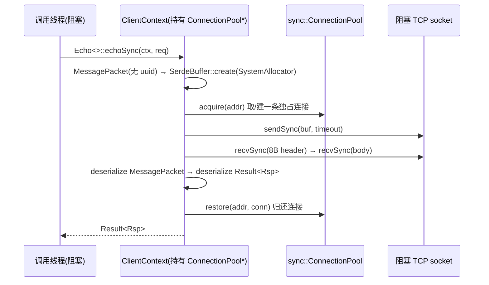

**文字说明**

同步调用在调用线程里完成,不经过 `Waiter`/`IOWorker`/`EventLoop`/`Processor`:构包(不带 uuid)→ 从 `ConnectionPool` 取一条独占连接 → 阻塞发送 → 先读 8 字节 header 再读 body → 两次反序列化 → 归还连接。超时从调用开始时刻起算,覆盖发送和接收的全过程。

同步路径**完全绕开** `Waiter / IOWorker / EventLoop / Processor`:一个请求独占一条连接、一问一答,超时按 `startTime + timeout` 在 send/recv 内部计算;不走 RDMA、也没有重试,适合 CLI/工具类场景。

## 4. 线程模型 (ThreadPoolGroup)

| 线程池 | 用途 |
|---|---|
| `EventLoop` 线程 (`num_event_loop`) | epoll,只做事件分发(`handleEvents` 置 flag 并投递任务) |
| `ioThreadPool` | Transport 读/写任务 (`doRead` / `doWrite`),可配置为在 EventLoop 线程内直接执行 |
| `procThreadPool` | `Processor::unpackMsg`、校验/解压/反序列化、业务方法协程(也可用 `DynamicCoroutinesPool` 替代) |
| `connThreadPool` | 建立连接 (`IOWorker::startConnect`)、重试等待 (`waitAndRetry`)、`Listener` 的 accept 协程 |
| `bgThreadPool` | 后台任务,如 `ServiceGroup::checkConnectionsRegularly` 定期清理过期/失效连接 |
| `Waiter` 自带的 `Timer` 线程 | 全进程唯一,管理所有请求的超时小根堆 |

## 5. Transport 读写状态机(flags_)

`Transport::flags_` 是一个 32 位原子变量,用来在 epoll 线程、io 线程、调用线程之间**无锁协调**读写任务,核心目的:同一方向同时只有一个任务在跑,并且不丢唤醒。

| 位 | 含义 |
|---|---|
| `Invalidated` | 连接已失效,所有路径收到后走清理 |
| `ReadAvailable` / `WriteAvailable` | socket 当前"可读/可写"(由 EPOLLIN/OUT 置位;读到 EAGAIN/写满后清除) |
| `ReadNewWaked` / `WriteNewWaked` | 上一轮任务运行期间又来了新的 epoll 事件(防丢唤醒) |
| `WriteHasMsg` | 写任务已被拉起/正在运行 |
| `WriteNewMsg` | 写任务运行期间又有新消息入队 |
| `LastReadFinished` / `LastWriteFinished` | 失效后读、写任务各自已收尾 |

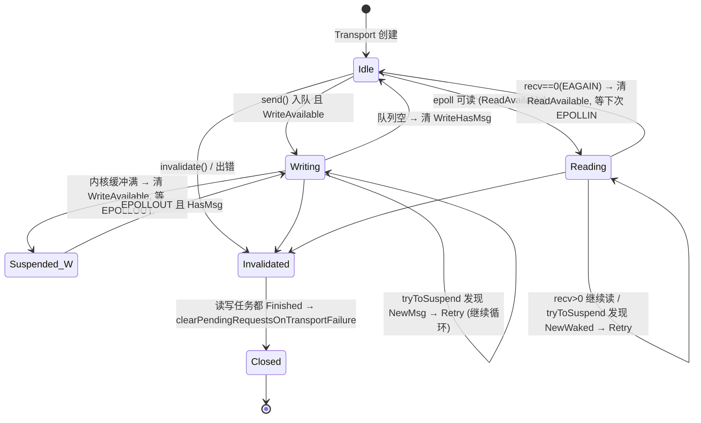

### 5.1 同端口 HTTP(`enable_http`)

服务端 TCP 连接的第一次 `doRead` 看首字节:`0x86/0x87` 走 serde,其他在 `Processor::Config::enable_http=true` 时走 `Transport::doHttp`,只处理一条 `GET`/`HEAD`/`POST` 请求(POST 需路由 `allowPost`,body 靠 `Content-Length` 读完、上限 `http_max_body_size`),内联回包后 `invalidate(false)` 关连接;请求头或 body 未收全时回到读循环,由 `tryToSuspend` 挂起。解析/序列化在 `common/net/http/Http.{h,cc}`,路由由 `ServiceGroup::addHttpRoute` 注册,`Server` 默认提供 `/`、`/server`、`/connections`。详见 `docs/http-sniff.md`、`docs/http-post-head.md`。

## 6. RDMA 实现(`common/net/ib`)

核心思路:**用 RDMA 的 SEND/RECV 模拟 TCP 字节流承载 RPC(控制面),用单边 READ/WRITE 传大块数据(数据面)**。`IBSocket` 继承 `Socket`,与 `TcpSocket` 接口一致,上层 `Transport / IOWorker / EventLoop / Processor` 不区分协议。

### 6.1 分层与数据通路

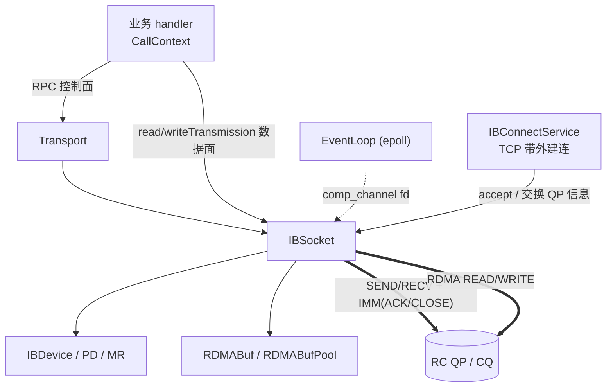

### 6.2 建连时序(TCP 带外交换 QP 信息)

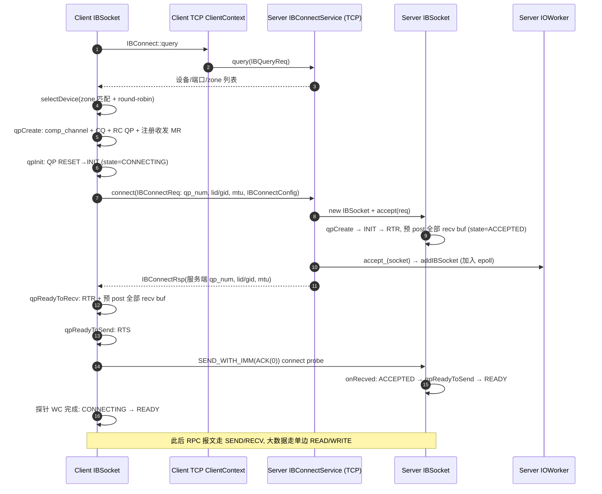

### 6.3 小消息通路(SEND/RECV 模拟字节流 + credit 流控)

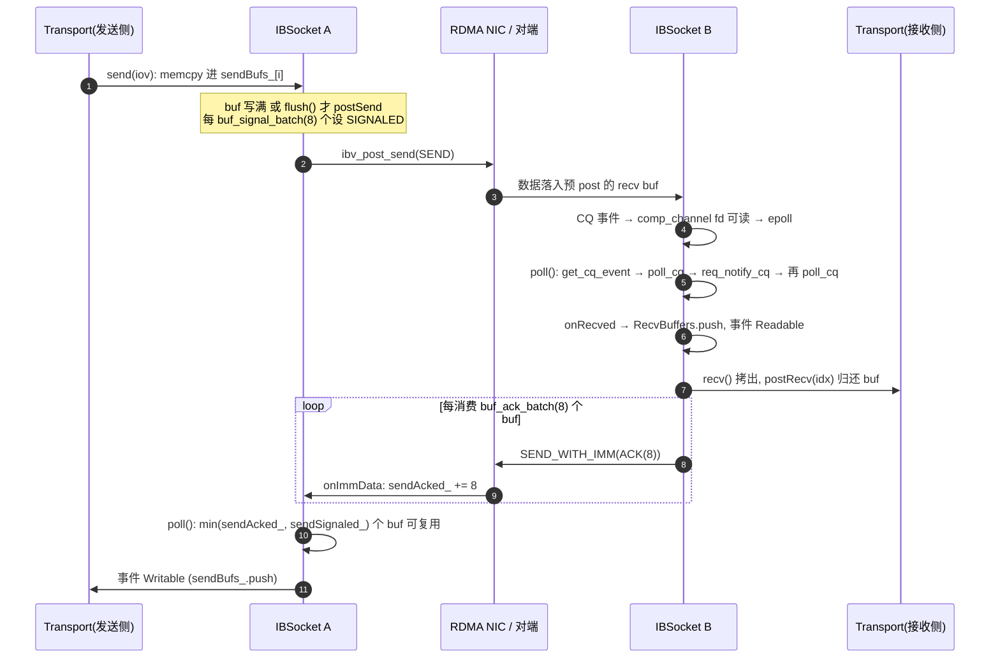

### 6.4 单边 RDMA READ/WRITE(handler 零拷贝读写对端内存)

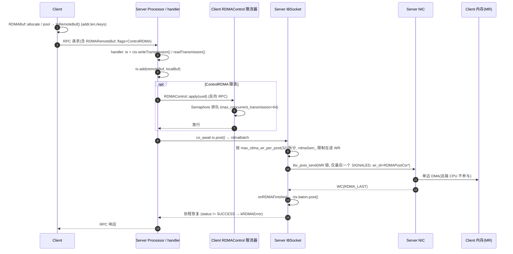

### 6.5 IBSocket 状态机与关闭

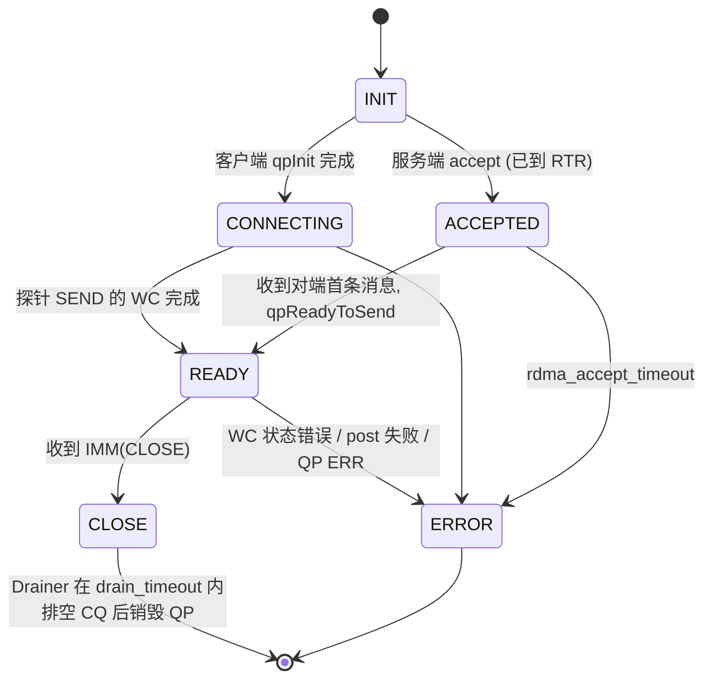

### 6.6 要点

- **流控**:接收方每消费 `buf_ack_batch` 个 buf 回一个 `SEND_WITH_IMM(ACK(n))`,发送方只复用「已 signaled 且已 ack」的 buf,保证对端 RQ 不会 RNR。
- **WR 预留**:`qpMaxSendWR = send_buf_cnt + ackBufs + max_rdma_wr + close + check`,CQ 容量为 SendWR + RecvWR,按此预分配以避免溢出。
- **`wr_id` 编码**:`StampedPtr` 把「类型 + 指针/索引」打包进 64 位,类型有 `SEND/RECV/ACK/RDMA/RDMA_LAST/CLOSE/CHECK`;`RDMA_LAST` 直接携带 `RDMAPostCtx*`,完成时 `baton.post()` 唤醒协程。
- **内存**:`RDMABuf` 每设备一个 MR,`RDMARemoteBuf`(addr, len, 每设备 rkey)可 serde 后随 RPC 发给对端;`RDMABufPool` 复用已注册 buf,避免频繁 `reg_mr`。
- **限流**:`RDMAControl`(service id 10)由数据持有方用信号量限制并发传输数(默认 64),防止 incast。
- **配置**:`IBSocket::Config` / `rdma_connect_timeout` 等均为热更新配置项。
